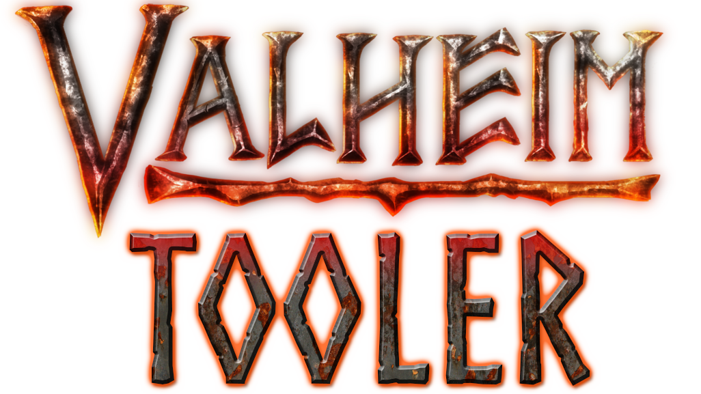

> [!CAUTION]
> Ce projet n'est plus maintenu ni mis à jour. Il est conservé uniquement à des fins archivistiques.
> 
> Si vous cherchez une alternative active, veuillez utiliser [Valheim Admin Tool](https://thunderstore.io/c/valheim/p/QoLTeam/Valheim_Admin_Tool/)

<h1 align="center">
   
  
</h1>

  
  
  
  
  

  

    <a href="./README.md">Version anglaise </a>

  <a href="#a-propos">A propos</a> •
  <a href="#utilisation">Utilisation</a> •
  <a href="#contribution">Contribution</a> •
  <a href="#mentions-spéciales-et-crédits">Mentions spéciales et crédits</a>

## A propos

ValheimTooler est un logiciel gratuit qui permet de tricher sur le jeu Valheim au travers d'une multitude d'options offertes. Ce projet est purement à but éducatif, je ne suis pas responsable de l'utilisation que vous en ferez. Soyez raisonnable certaines fonctionnalités peuvent altérer négativement l'expérience de jeu des autres joueurs.

Voici la liste des fonctionnalités disponibles:

* **Joueur**
  * Vie infinie, vous ne perdez plus de vie !
  * Endurance illimitée pour vous
  * Endurance illimitée pour les autres joueurs
  * Retirez l'endurance des autres joueurs
  * Mode vol, vous pouvez voler 🕊️
  * Mode fantôme, les monstres ne vous voit pas
  * Pas de coût d'emplacement, vous pouvez tout construire
  * Explorer toute la minimap (Cette action est irréversible sur le monde sur lequel vous l'activez)
  * Réinitialiser la minimap
  * Se téléporter à un autre joueur (fonctionne seulement si le joueur s'est affiché sur la minimap), sur un marquage de la carte ou à des coordonnées
  * Permettre la téléportation avec des objets normalement interdits
  * Soignez instantanément un joueur
  * Soignez instantanément tous les joueurs
  * Activer un pouvoir du gardien au choix pour vous
  * Activer un pouvoir du gardien au choix pour tous les joueurs
  * Changez le niveau d'une compétence
  * Apprivoiser toutes les créatures proches
  * Poids illimité pour l'inventaire
  * Craft instantané
  * Supprimer ses tombes
  * Changer la distance d'intéraction
* **Entités et objets**
  * Faites apparaitre n'importe quel entité/objet
  * Supprimer tous les drops à proximité
  * Une interface est disponible pour vous ajouter n'importe quel objet dans votre inventaire
* **Modificateur de Terrain**
  * Mettre à niveau
  * Abaisser
  * Augmenter
  * Annuler les modifications
  * Lisser le terrain
* **Autres**
  * Infligez des dégâts à un joueur (ignore le mode non-pvp)
  * Tuez tous les monstres
  * Tuez tous les joueurs (sauf vous)
  * Auto-marquage sur la map des dépôts
  * Envoyez un message d'évènement aux autres joueurs (Le gros message jaune au milieu de l'écran)
  * Envoyer un message dans le chat avec la possibilité d'usurper l'identité d'un autre joueur
  * Un ESP pour les joueurs, monstres, les objets ramassables, les dépôts et les drops avec une distance réglable

**⚠️ Attention ⚠️**: Sur chaque fonctionnalité permettant de choisir un joueur, la liste ne comportera que les joueurs qui sont à une certaine distance de vous (assez grande mais pas toute la carte pour autant). Ce n'est pas un choix personnel mais une limitation technique du jeu. Jusqu'à ce que je trouve un moyen de le contourner (si c'est possible) ce comportement restera.

## Utilisation

je me suis assuré que l'installation et le lancement du cheat soit le plus simple possible. Rendez-vous simplement [ici](https://github.com/Astropilot/ValheimTooler/releases) pour télécharger la dernière version. Prenez le .zip et extrayez-le dans n'importe quel dossier. Puis lancez le programme `ValheimToolerLauncher.exe` et cliquez sur `Install`.

Si le bouton n'est clickable, c'est très certainement car le launcher n'a pas réussi à trouver de lui même le chemin vers le jeu. Spécifiez le chemin en dessous du bouton.
Le chemin le plus probable est quelque chose du genre: `C:\Program Files (x86)\Steam\steamapps\common\Valheim`.
Une fois le chemin correct choisi le bouton devrait être disponible.

Une fois l'installation finit, lancez Valheim et une fois sur le menu principal du jeu (ET PAS AVANT), vous pouvez cliquer sur le bouton `Launch` et le programme de triche devrait apparaitre à l'intérieur du jeu. Pour afficher/masquer la fenêtre du cheat utiliser la touche du clavier `Suppr`.

Quand une mise à jour du cheat est disponible, le launcher vous préviendra et vous n'aurez qu'à cliquer dessus pour installer automatiquement la dernière version.

Si vous souhaitez désinstaller le programme vous n'avez qu'à cliquer sur `Uninstall`.

**Note**: Si l'installation ou la désinstallation empêche votre jeu de se lancer, rendez-vous sur Steam, faites clique droit sur le jeu puis "Propriétés" et dans l'onglet "Fichiers locaux" appuyez sur "Vérifier l'intégrité des fichiers du jeu...". Steam réparera automatiquement les fichiers corrompus.

Voici également une vidéo tutoriel pour installer le programme et aussi une démonstration des fonctionnalités du cheat:

### Configuration

Un fichier de configuration est disponible pour modifier certains des paramètres de l'outil, ce fichier est créé lors du premier lancement de l'outil.
Le fichier est disponible :
- Si vous utilisez le launcher, le fichier devrait apparaître au même endroit que le `ValheimToolerLauncher.exe`.
- Si vous utilisez la version moddé BepInEx, il devrait être disponible dans le dossier `BepInEx/config`.

Le nom du fichier de configuration est `valheimtooler_settings.cfg`.

Ce fichier vous permet de modifier les paramètres suivants:
- Changer la touche qui permet d'afficher/cacher l'outil, par défaut sur la touche Delete
- Choisir d'afficher l'outil lorsqu'il démarre, actif par défaut
- Choisir la langue d'affichage du programme, auto par défaut (en fonction de la langue du jeu)
- Choisir des raccourcis clavier pour certaines fonctionnalités

## Contribution

Le projet est ouvert aux contributions ! Ouvrez une Issue pour proposer de nouvelles fonctionnalités ou faites directement une merge request si vous souhaitez l'implémenter vous-même. Merci de respecter les conventions définies par l'editorconfig ! Il devrait être pris en compte automatiquement par Visual Studio.

Un fichier de contribution plus complet arrivera sous peu...

## Mentions spéciales et crédits

* Un merci aux forums [Guided Hacking](https://guidedhacking.com/threads/how-to-hack-unity-games-using-mono-injection-tutorial.11674/) et [Unknown Cheats](https://www.unknowncheats.me/forum/unity/285864-beginners-guide-hacking-unity-games.html) pour leurs tutoriels m'ayant permis de m'initier au développement de cheat sur Unity
* De gros merci à [wh0am15533](https://github.com/wh0am15533) pour son outil [Unity Runtime DevTools](https://www.unknowncheats.me/forum/unity/388951-unity-runtime-devtools-v1-01-a.html) d'où j'ai récupérer quelques morceaux de code pour le chargement au runtime de ressources présentes dans mon assembly et sa mise à jour du [SharpMonoInjector](https://github.com/wh0am15533/SharpMonoInjector)
* Merci à [KillerGoldFisch](https://github.com/KillerGoldFisch) pour sa proposition de mettre cet outil sous forme de mod pour BepInEx ainsi que [son code d'exemple]((https://github.com/KillerGoldFisch/ValheimToolerLoaderMod)) pour la mise en place de ce plugin
* Merci à [themaoci](https://github.com/themaoci) pour son travail permettant de refaire une partie des fonctionnalités via le patching ainsi que l'ajout de nouvelles fonctionnalités comme: l'auto-marquage sur la minimap des dépôts, le craft instantané et la téléportation avec objets interdits
* Merci au [mod Gungnir](https://github.com/zambony/Gungnir) pour le code concernant la modification de terrain
* Merci à [BepInEx](https://github.com/BepInEx/BepInEx) pour le système de configuration réutilisé dans ce code
* Pleins de bisous à [BastienMarais](https://github.com/BastienMarais) pour son aide pendant la phase de développement pour m'avoir aidé à tester certaines fonctionnalités et m'avoir donné de nouvelles idées !
